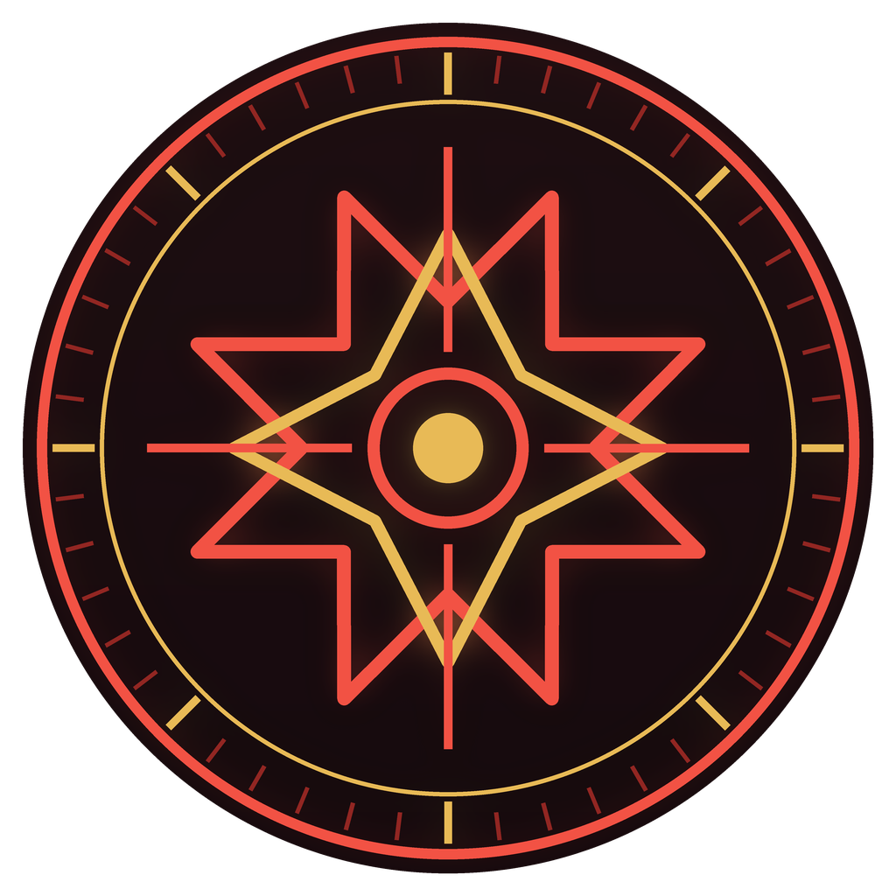

# AoC Native for Android

**AoC Native** (`io.github.p1r4n351.hwaoc`) runs **Hyrule Warriors: Age of Calamity 1.3.0** (title `01002B00111A2000`)
natively on Android handhelds with a Qualcomm Adreno GPU. It is not an emulator: the game's code modules are rewritten
once for Android and run directly on the device's processor, and its graphics are drawn through the shared NVN-on-Vulkan
layer. It is built on [TotK Native](https://github.com/AurelioB/totk-android), the native Tears of the Kingdom port,
and shares its Horizon runtime, graphics layer and controller menu. The app contains **no game files**: you supply your
own dump of the game.

**Beta, developer route only.** The release flavour is `0.1.0-beta.1`. The app's own setup cannot import this game yet
(`ondevice_setup = false`): the game folder is prepared on a computer and staged by hand.

- [Status](#status)
- [Requirements](#requirements)
- [Install and setup](#install-and-setup)
- [Saves](#saves)
- [Second screen](#second-screen)
- [Known limitations](#known-limitations)
- [For developers](#for-developers)
- [This tree also builds](#this-tree-also-builds)
- [Support](#support) · [Credits](#credits) · [License](#license) · [Legal](#legal)

## Status

Milestones M0–M7 are verified on `1.3.0` (`v327680`), as recorded in [games/hwaoc/README.md](games/hwaoc/README.md):

- All three code modules (`subsdk0`, `sdk`, `main`) pass `patch_nso.py`, `structck.py` and `equiv.py`.
- Vulkan graphics are verified through VP9 cutscenes and 3D battle rendering, with `0` unimplemented NVN symbols.
- `53` shader rows are harvested into [games/hwaoc/assets/shader_list.tsv](games/hwaoc/assets/shader_list.tsv), with
  `0` warm misses on the covered scenes.
- Save management for the game's flat `svdt` save is wired (`SaveManager.FLAT_SAVE`).
- The `AoC Native` APK flavours (`0.1.0-beta.1` release, `0.1.0-dev` debuggable) build with `tools/build_app.sh`, with procedural Calamity star-gear main-menu emblem (`b5bb6f3`), AYN handheld Controller style detection (`6e6a5c1`, staged upstream on `P1R4N351/totk-android:ayn-controller-style`), and Vulkan fast-path optimizations (Opts 45–60).
- **Milestone M7 (Second Screen):** Clean-room MIT Warriors companion (`ktgl_companion.h`, shared with [AoI Native](https://github.com/P1R4N351/hwaoi-android) and [`P1R4N351/nx-second-screen` `v0.3.0`](https://github.com/P1R4N351/nx-second-screen/releases/tag/v0.3.0)) verified live on AYN Thor Display 4 (`1240x1080`).

What differs from Tears of the Kingdom in the runtime (heap split, memory reserve, NVN level, shader list, saves):
[games/hwaoc/ANDROID.md](games/hwaoc/ANDROID.md).

## Requirements

- **Android 13 or newer** (API 33), 64-bit (arm64).
- **A Qualcomm Snapdragon chip with an Adreno GPU.** The app bundles the Mesa Turnip Vulkan driver.
- **Storage**: the merged RomFS image is `11,719,230,892` bytes (`1,101` files), plus the rewritten code modules and
  game data.
- **Your own, legally dumped copy of the game, version 1.3.0** (`v327680`, `main` build id
  `C3CF52BF2B05D7310884971B50BCCCB8`): the base game and the 1.3.0 update, with the keys of your own console.
- **A computer** with Python 3 to prepare the game folder, and `adb` to copy it to the device.

## Install and setup

1. Download `AoC-Native-<version>.apk` (and its `.sha256`) from the
   [Releases page](https://github.com/P1R4N351/hwaoc-android/releases). Releases are tagged `hwaoc-v<version>`.
2. Prepare the game folder on a computer from your own dump: rewrite the three code modules (`main`, `subsdk0`, `sdk`)
   with `patch_nso.py`, merge the base game and the 1.3.0 update into one RomFS image and index it, and prepare the
   shader seed with `games/totk/scripts/prepare_hwaoc_seed.py`.
3. Stage the files on the device as laid out in
   [ANDROID.md → Staging layout on Thor](games/hwaoc/ANDROID.md#staging-layout-on-thor-developer-probe-route).

Nothing is uploaded: your files stay on your computer and your device.

## Saves

The game keeps one flat save file, `user-data/save/<uid>/svdt` (`1,048,576` bytes), with no slot folders. The menu's
save manager exports, imports and backs it up through `SaveManager.FLAT_SAVE`.

## Second screen

**AoC Native** ships the converged clean-room **MIT Warriors Second-Screen Companion** (`ktgl_companion.h`, shared with
[AoI Native](https://github.com/P1R4N351/hwaoi-android) and published standalone in
[`P1R4N351/nx-second-screen` `v0.3.0`](https://github.com/P1R4N351/nx-second-screen/releases/tag/v0.3.0)). On dual-screen
handhelds such as the AYN Thor (Display 4, `1240x1080`), it attaches a `FLAG_NOT_FOCUSABLE | FLAG_KEEP_SCREEN_ON`
`Presentation` with four evenly-spaced tabs (`RADAR`, `ACTIONS`, `COMBOS`, `STATUS`), a 128-point inertial trail with
8 tactical waypoint pins, fail-closed Sheikah Rune (`R`) / Rod (`L`) / party / combo chords, cutscene auto-dimming,
AMOLED pixel-orbit burn-in protection, and Bifrost LED sync. The APK continues to exclude GPL-3.0 Eden Duo companion
assets (`gpl_companion = false`; enforced by `apk/audit_apk.py`). Engine hook notes:
[games/hwaoc/SECOND_SCREEN_NOTES.md](games/hwaoc/SECOND_SCREEN_NOTES.md).

## Known limitations

- Game version **1.3.0** only. The later `1.4.1` and the Expansion Pass DLC are not supported.
- **No on-device setup**: the game folder is prepared on a computer and staged by hand.
- No PC mod manager is supported for imports (`mod_manager = none`).
- The documented staging route is for the AYN Thor.
- Saves are removed with the app: export them first. A developer build cannot be updated in place by a release build:
  they are signed with different keys.

## For developers

- [games/hwaoc/README.md](games/hwaoc/README.md): dump identity, module inventory, rewriter results and bring-up
  hazards.
- [games/hwaoc/ANDROID.md](games/hwaoc/ANDROID.md): what differs from Tears of the Kingdom, and the staging layout.
- [games/hwaoc/SECOND_SCREEN_NOTES.md](games/hwaoc/SECOND_SCREEN_NOTES.md): engine hooks for the second screen.
- [docs/ktgl-commonalities.md](docs/ktgl-commonalities.md): KTGL engine commonalities shared with AoI Native.
- [MAINTENANCE.md](MAINTENANCE.md): the per-game variables (`games/games.toml`), building, testing and syncing with
  upstream.

Build: `tools/build_app.sh hwaoc {dev,release}`. Test: `tools/check_all.sh`.

## This tree also builds

The same code base builds two other apps; what differs between them is listed in [MAINTENANCE.md](MAINTENANCE.md):

- **TotK Native (fork)** (`io.github.p1r4n351.totk`): Tears of the Kingdom 1.4.3,
  [P1R4N351/totk-android](https://github.com/P1R4N351/totk-android).
- **BotW Native** (`io.github.p1r4n351.botw`): Breath of the Wild 1.6.0,
  [P1R4N351/botw-android](https://github.com/P1R4N351/botw-android).

## Support

If this work is useful to you, donations are gratefully accepted. They are voluntary, unlock nothing, and go to this port's maintainers (PiSCES), not to the upstream TotK Native (AurelioB) project.

- Bitcoin: `bc1q4a3lqcg87rvw7vxulausdqhhuwkwwa6w6v4mxx`
- VitaDB profile: [PiSCES](https://www.rinnegatamante.eu/vitadb/#/user/PiSCES)

Download builds only from this repository's [Releases](https://github.com/P1R4N351/hwaoc-android/releases). Nobody will ever ask you for keys, game files or account details.

## Credits

- **[totk-android](https://github.com/AurelioB/totk-android)** by AurelioB (MIT): the native Tears of the Kingdom
  Android port (TotK Native) this tree is based on, with its runtime, Vulkan backend, app and menu.
- **[MacNativeGames](https://github.com/ly05010419/MacNativeGames)** by ly05010419 and its contributors (MIT): the
  native port for Apple silicon this tree derives from, including its Age of Calamity notes (`games/aoc`) and the
  `expected-1.3.0.json` module digests the dump is checked against.
- **[d2r-mobile](https://github.com/jhaizhou-ops/d2r-mobile)** (MIT), **Ryujinx** (MIT) and the other components listed
  in [THIRD_PARTY_NOTICES.md](THIRD_PARTY_NOTICES.md).

## License

MIT (see [LICENSE](LICENSE)). The Eden Duo companion integration under `games/totk/duo` is GPL-3.0 and is not included
in the AoC Native APK. Third-party code keeps its own license: [THIRD_PARTY_NOTICES.md](THIRD_PARTY_NOTICES.md).

## Legal

**You must own the game.** Use this project only with a copy of Hyrule Warriors: Age of Calamity that you bought, and
with keys and system files dumped from your own Nintendo Switch. This is an independent, non-commercial project. It is
not affiliated with, endorsed by, or sponsored by Nintendo or Koei Tecmo. Hyrule Warriors, The Legend of Zelda and
Nintendo Switch are trademarks of their respective owners.

The repository and the APKs contain no game content and distribute none: no game program, art, text, audio, shaders or
keys, and they do not help to obtain them. Everything the game needs is made from your own files. The game data you
build is for your own use only; do not share it.
